# Tutorial: from album pages to finished photos

This walks through one small project from start to finish: three scanned album pages with eleven old prints on
them, some faded, some damaged, one stuck in sideways. Each step shows what you see and what to do.

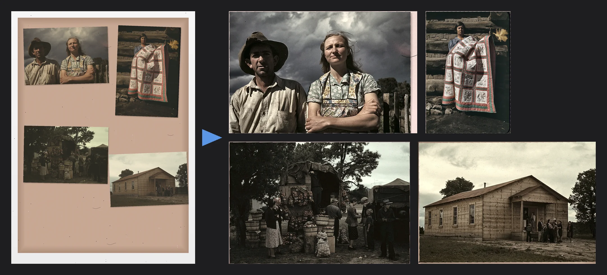

A PhotoCropper project is a folder. Each of the three stages writes its own files there and never changes the
ones before it, so you can go back to any stage at any time:

| Stage | What you do | What it writes |
|---|---|---|
| **1 Scan** | Scan album pages or import scan files | `RawScans/`: the pages exactly as scanned |
| **2 Crops** | Check the box around each photo and fix the few that need it | `Cropped/`: one lossless PNG per photo, straightened and turned upright |
| **3 Finish** | Restore colours, clean dust, repair damage | `Final/`: the photos to keep, as JPEG or PNG with metadata |

Everything is saved as you go. There is no Save button.

> The sample photos in this tutorial are public domain; see [image credits](images/CREDITS.md).

---

## 1. Start a project

Every launch begins at the start screen.

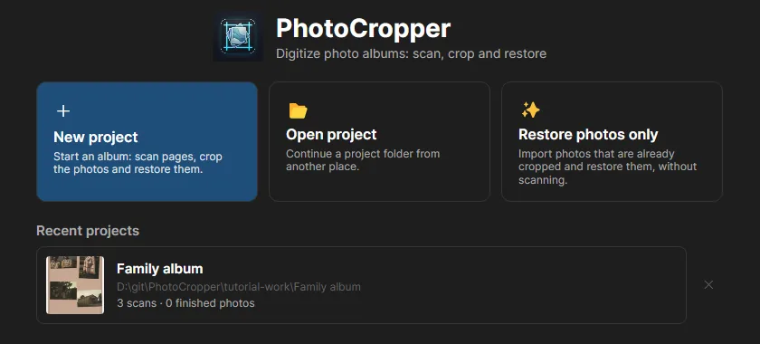

- **New project**: give it a name (for example the album's) and a location. The folder is created for you.
- **Open project**: continue a project folder from somewhere else.
- **Restore photos only**: for photos that are already cropped (from a phone, another program, an earlier
  scan). It skips straight to step 3.
- **Recent projects** shows each one with a thumbnail and how far it got. Click one to continue it.

The project's name on the top bar brings you back here to switch projects.

## 2. Scan the pages

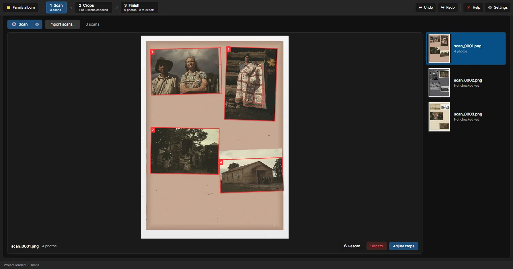

Put a page on the scanner and click **Scan** (or press `F5`). The ⚙ next to it sets up the scanner and the
resolution: 300 DPI suits ordinary prints, 600 DPI small ones or ones you may want to enlarge. If you already
have scan files, use **Import scans…** or drag them onto the window.

Each new scan is shown large with the photos found on it outlined, so you can see right away whether the page
went well:

- **Rescan** scans the page again and puts the new scan in its place (useful if a photo moved or the lid
  wasn't closed).
- **Discard** removes the scan and its photos (click twice to confirm).
- The list on the right shows every scan with how many photos it has. A red warning means **no photos were
  found**; you'll fix that in the next step.

You don't have to finish scanning first: you can move between stages whenever you like.

## 3. Check the crops

Click **2 Crops** on the top bar (or **Adjust crops** on a scan). The scan is on the left with a box around each
photo; the photos as they will be cropped are on the right. `↑` / `↓` or the ◀ ▶ buttons move between scans.

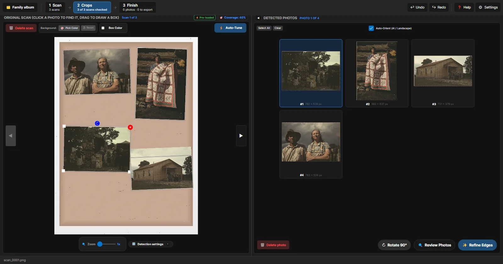

Most scans need nothing. The stage bar's **"3 of 3 scans checked"** only counts scans that have been looked at
by the detector; you don't have to open every one, and scans you never open are cropped automatically when you
go to Finish.

Look at the thumbnails on the right. In this page, two things are wrong:

- **#2 is upside down.** Automatic orientation gets most photos right (it looks for faces, sky and landscape),
  but not all. Select the photo and click **Rotate 90°** (or press `R`) until it's upright.
- **Box 4 cuts off the church's sky.** The pale sky was taken for the page. See the next section.

### Fix a box that's wrong

Turn on **Find Photo** (🎯) and click **inside the box**: the box is fitted to the photo again. Clicking inside a
photo that has **no box** adds one.

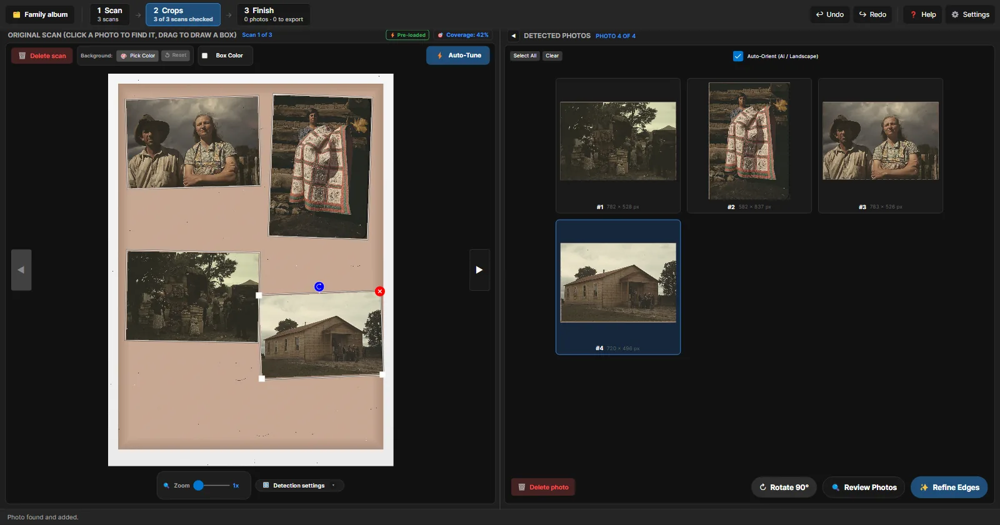

You can also fix a box by hand:

- drag a **corner** to resize it (a magnifier shows the edge while you drag),
- drag the **blue circle** above it to turn it,
- click the **red ×** to delete it (for example a box around something that isn't a photo).

All of this also works while **Find Photo** is on, so you can fix boxes and find photos without switching it off.

`Ctrl+Z` undoes any change.

### When no photos are found: draw the boxes yourself

Some pages defeat the automatic detection. Here the photos are on a dark grey page, and nothing is found:

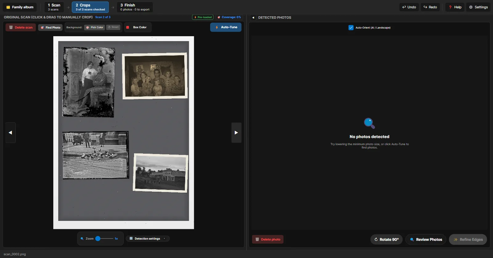

First try **Auto-Tune**, which searches for detection settings that work on this scan. If that doesn't help,
**click and drag** on the scan to draw a box around each photo. The box doesn't have to be exact; you can fix
its corners afterwards.

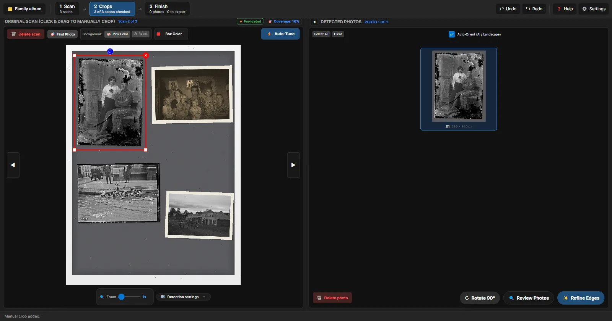

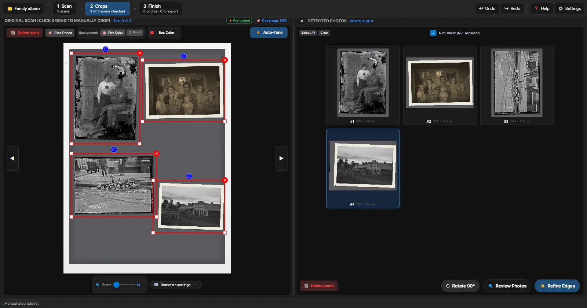

Here #3 came out sideways; **Rotate 90°** fixes it as before.

### Photos stuck in sideways

Photos that are turned on the page are turned upright for you. The father and daughter below are sideways on the
scan but upright in the cropped photo (#1):

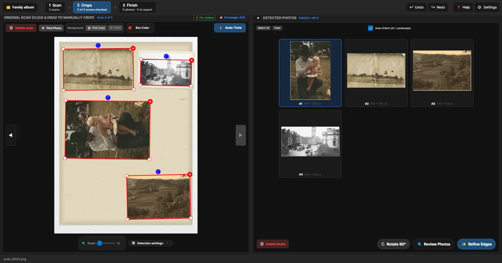

**Review Photos** shows every photo full-size, one after another, which is the quickest way to check orientation
across a whole album: `→` or `Space` for the next, `R` to rotate, `Delete` to drop one, `Esc` to go back.

## 4. Restore and finish

Click **3 Finish**. Every cropped photo is here as a card, labelled with the kind of print it is: black & white,
sepia, faded colour or colour. The chips above the grid show one kind at a time.

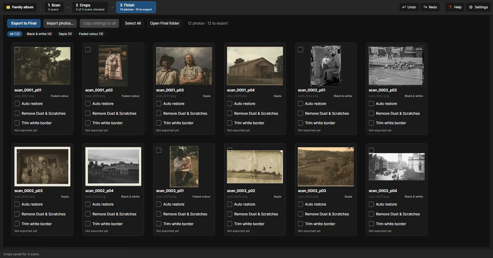

### Restore many photos at once

Click **Select All** (or Ctrl+click / Shift+click photos, or tick their boxes). A bar appears with what you can
do to all of them. **Suggested by type** gives each one the preset that suits its kind of print:

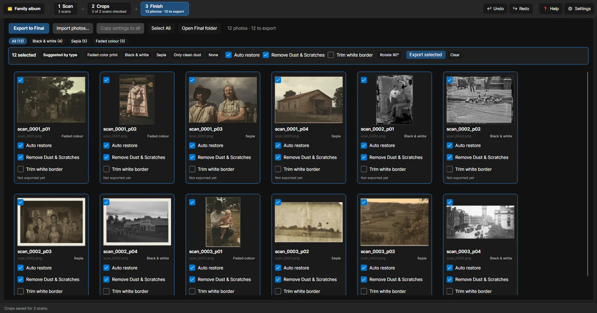

The other buttons on the bar apply one preset to all selected photos, turn automatic restoration, dust removal or
border trimming on or off, rotate them, or export just those photos.

### Look at one photo closely

Click a photo to open it in the editor. The divider shows the photo **before** (left) and **after** (right,
exactly as it will be exported); drag it, or hold `Space` to see the original. Zoom with the mouse wheel, and use
`←` / `→` or the filmstrip to move between photos.

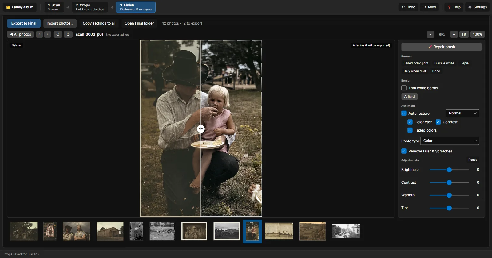

On the right:

- **Presets** for common kinds of print.
- **Border: Trim white border** leaves out a print's white or cream border; **Adjust** lets you set exactly what
  is kept.
- **Automatic: Auto restore** fixes colour casts, contrast and faded colours, at the strength you choose.
  **Photo type** decides whether a black-and-white print keeps its tone (sepia) or becomes neutral grey.
- **Remove Dust & Scratches** cleans specks and hairs.
- **Adjustments**: brightness, contrast, warmth, tint and saturation by hand.

### Repair damage

Prints with stains, tears or flaking need the **Repair brush**:

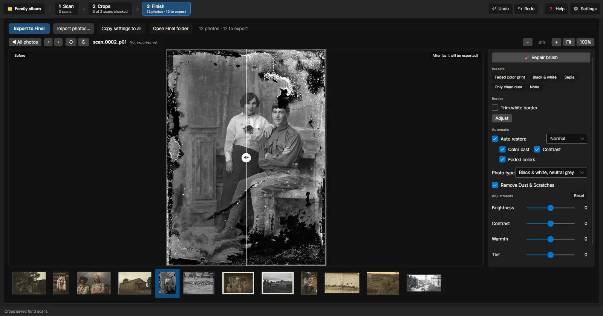

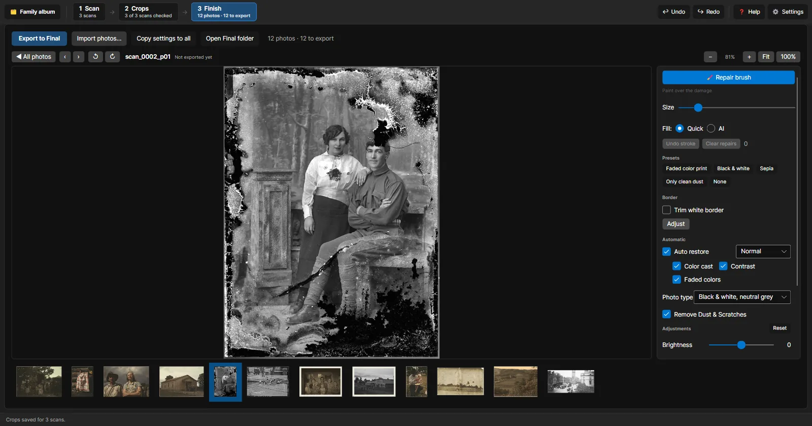

Paint over the damage and it is filled in from its surroundings. **Quick** fill suits scratches, creases and
small stains. **AI** fill continues the picture (walls, sky, grass, clothing) and is better for large damage and
torn corners; it needs a one-time 208 MB download and runs on your computer. Strokes are kept with the photo, so
you can undo or clear them later.

### Export

Click **Export to Final**. The photos are written to the project's `Final/` folder, and each card shows
**Exported**. **Open Final folder** takes you there.

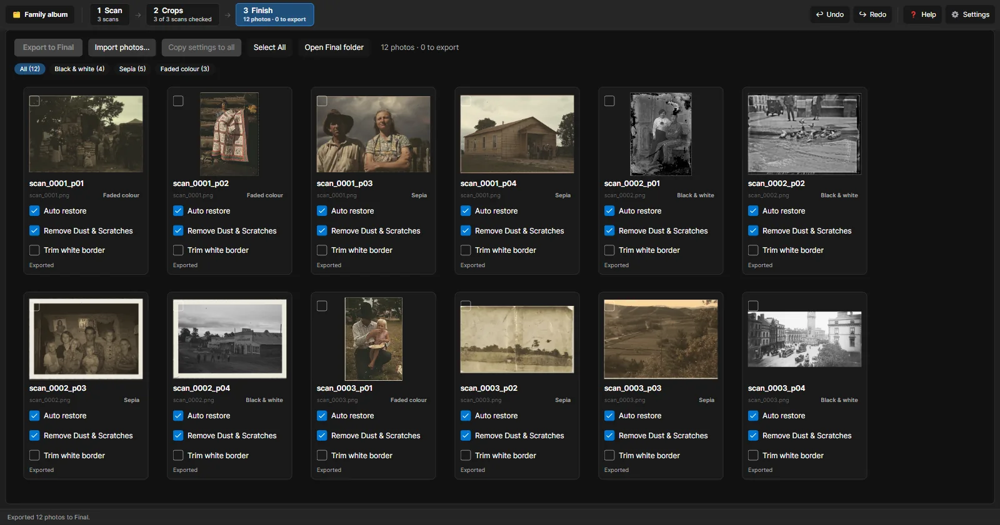

If you change a photo later (a crop, a setting, a repair), its card shows **Changed since export**, and the next
export only writes the photos that changed. Format, quality, file names and the year written into the photos'
metadata are in **Settings → Export settings…**.

---

## Tips

- **Scan at 300 DPI** for normal prints; 600 DPI for small prints or anything you may want to print larger.
- **Leave a gap between photos** on the scanner bed when you can; touching photos are harder to separate.
- **Close the lid** or put a sheet of plain paper behind loose prints so the background is even.
- **Back up `RawScans/`**: everything else can be made again from it.
- Press `F1` in the app for the full help and every keyboard shortcut.
